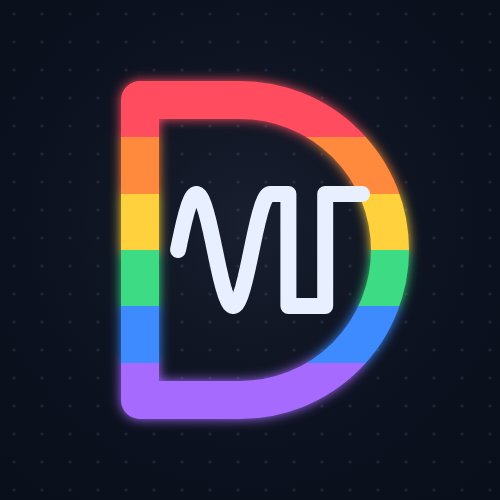
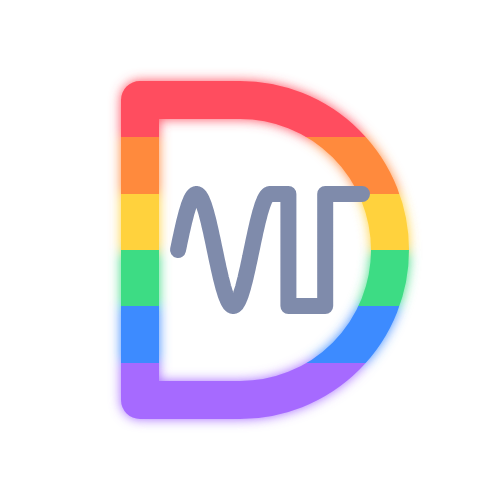

# D-Modem brand

Logos, colours, type and the naming guide for the D-Modem organization.

 

A **D** with a carrier wave inside that starts as a sine and ends as square
pulses: analog in, digital out. The D is striped in the colors of the CD
"Rainbow Books", one per repository. The faint dot grid behind it is a QAM
constellation.

| File | Use |
| --- | --- |
| `avatar/org-avatar.png` (500px), `@2x` (1000px) | GitHub org profile picture |
| `avatar/mark.svg`, `mark.png`, `mark@2x.png` | Transparent mark for READMEs and docs |
| `social/<repo>.png` (1280×640) | GitHub social preview for each repo |
| `app-icon/ic_launcher.svg`, `play-store.png` (512px) | Android app launcher icon and Play Store icon |

## Quick start

    python3 tools/gen.py && python3 tools/app_icon.py && node tools/render.js

regenerates every SVG and PNG ([docs/assets.md](docs/assets.md)).

## Documentation

- [Naming guide](docs/naming.md): how the repositories, programs and boards are named
- [README template](docs/readme-template.md): the landing page every repository's README follows
- [Palette, type and the app icon](docs/palette.md)
- [Assets](docs/assets.md): previews, uploading to GitHub, regenerating

## The D-Modem suite

| Repository | What it is |
| --- | --- |
| [D-Modem](https://github.com/D-Modem/D-Modem) | The open V.92 softmodem: dmodemd, libdmodem and the Asterisk, FreeSWITCH and ARI modules |
| [app](https://github.com/D-Modem/app) | The D-Modem app for Android and iOS: a dial-up modem on a SIP call |
| [hardware](https://github.com/D-Modem/hardware) | pico-serial: RP2040 serial adapters and phone-line USB sticks |
| [menu](https://github.com/D-Modem/menu) | modemmenu: the login and menu dial-up callers reach |
| [bbs](https://github.com/D-Modem/bbs) | A bulletin board for telnet, SSH, TN3270 and modem callers |
| [go3270](https://github.com/D-Modem/go3270) | A Go library for 3270 terminal servers, used by bbs |
| [brand](https://github.com/D-Modem/brand) | Logos, colours, type and the naming guide |

## Licence

AGPL-3.0-only ([LICENSE](LICENSE)), or a commercial licence from the D-Modem Authors ([COMMERCIAL-LICENSE.md](COMMERCIAL-LICENSE.md)). Contributions come with a contributor agreement ([CONTRIBUTING.md](CONTRIBUTING.md)).
