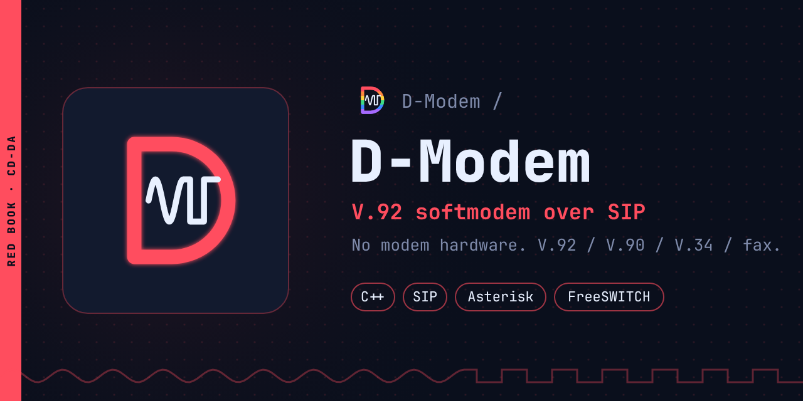
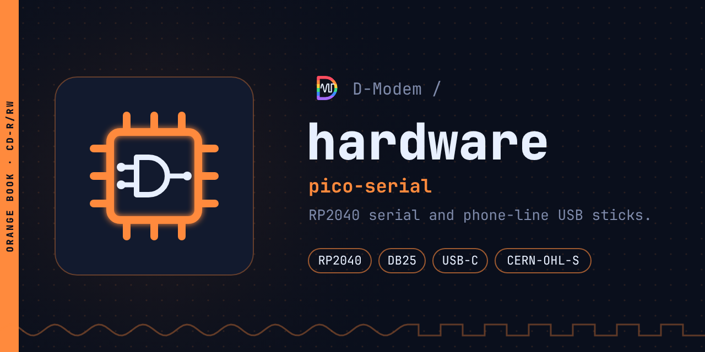
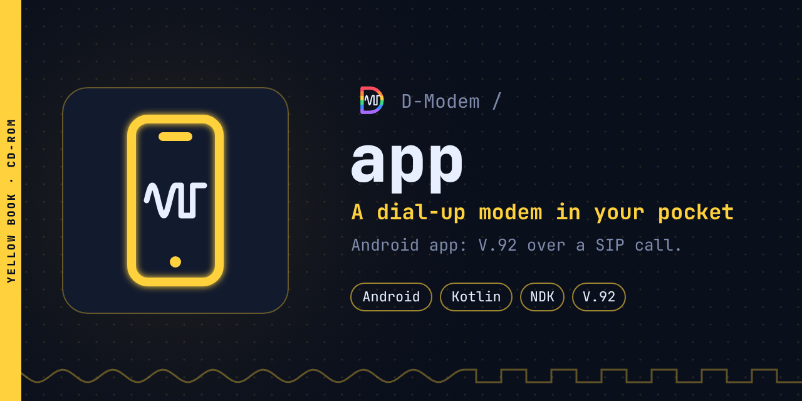
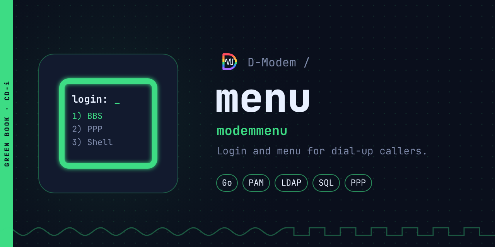
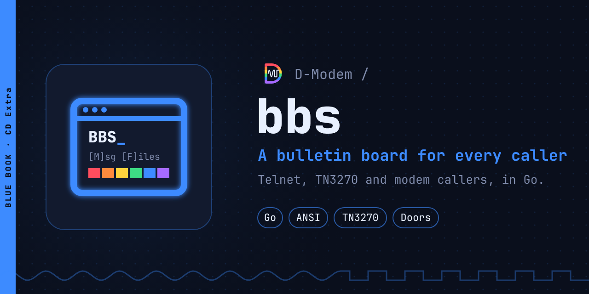
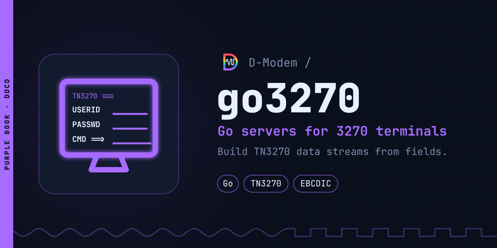

# D-Modem brand

Logos and GitHub images for the D-Modem organization.

## The mark

 

A **D** with a carrier wave inside that starts as a sine and ends as square
pulses: analog in, digital out. The D is striped in the colors of the CD
"Rainbow Books", one per repository. The faint dot grid behind it is a QAM
constellation.

| File | Use |
| --- | --- |
| `avatar/org-avatar.png` (500px), `@2x` (1000px) | GitHub org profile picture |
| `avatar/mark.svg`, `mark.png`, `mark@2x.png` | Transparent mark for READMEs and docs |
| `social/<repo>.png` (1280×640) | GitHub social preview for each repo |

## Palette

Each repository takes one Rainbow Book. Its color is the accent on its social
preview, and the book and format are named on the spine down the left edge.

| Book | Format | Color | Repository |
| --- | --- | --- | --- |
| Red | CD-DA | `#ff4d5e` | [D-Modem](https://github.com/D-Modem/D-Modem) |
| Orange | CD-R/RW | `#ff8a3d` | [hardware](https://github.com/D-Modem/hardware) |
| Yellow | CD-ROM | `#ffd23d` | [app](https://github.com/D-Modem/app) |
| Green | CD-i | `#3ddc84` | [menu](https://github.com/D-Modem/menu) |
| Blue | CD Extra | `#3d8bff` | [bbs](https://github.com/D-Modem/bbs) |
| Purple | DDCD | `#a66bff` | [go3270](https://github.com/D-Modem/go3270) |

White (Video CD), Beige (Photo CD) and Scarlet (SACD) are free for future
repositories.

Neutrals: background `#0a0f1c`, panel `#121a2e`, text `#e8f0ff`, muted
`#7f8bab`. Type: [JetBrains Mono](https://www.jetbrains.com/lp/mono/).

## Previews

| | |
| --- | --- |
|  |  |
|  |  |
|  |  |

## Uploading to GitHub

GitHub has no API for these, so they are uploaded by hand:

- **Org avatar:** the organization's Settings → Profile → Profile picture →
  upload `avatar/org-avatar@2x.png`.
- **Social previews:** each repository's Settings → General → Social preview →
  Edit → Upload an image → `social/<repo>.png`.

## Regenerating

The SVGs are generated by `tools/gen.py` (colors, taglines and tags are at
the top of it) and rendered to PNG by `tools/render.js` with Playwright's
Chromium. JetBrains Mono must be installed for the text to render as
intended; the SVGs name it as their font, so viewers without it fall back to
another monospace font.

    python3 tools/gen.py
    node tools/render.js
