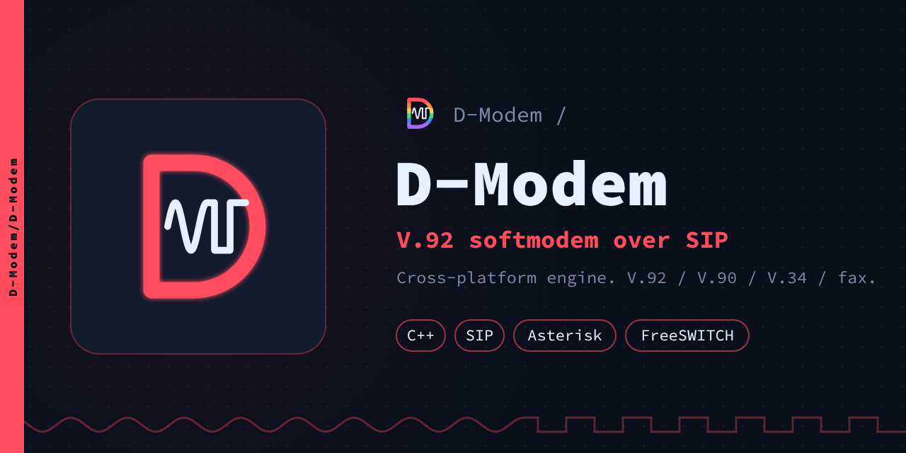
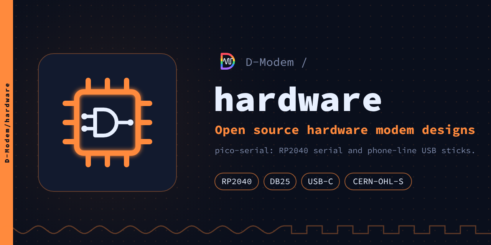
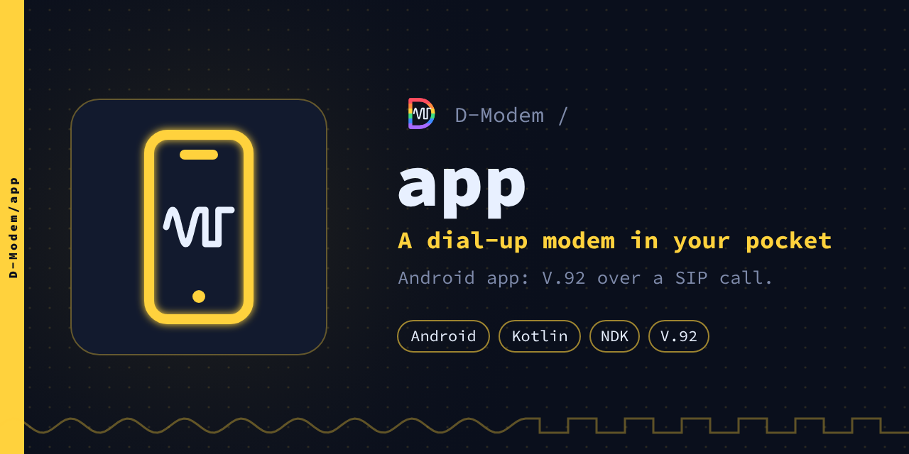
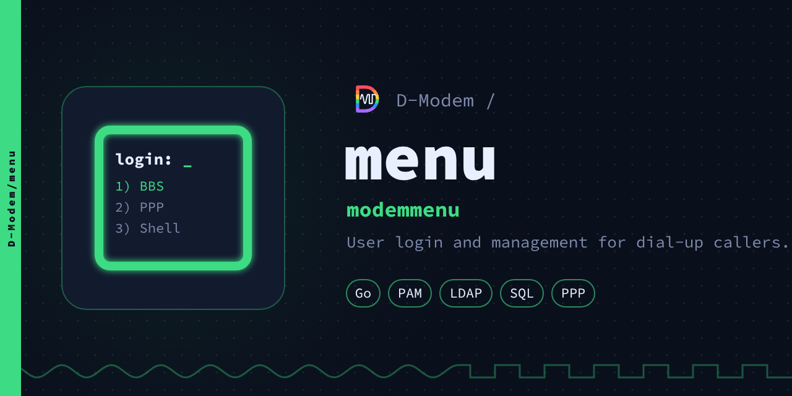
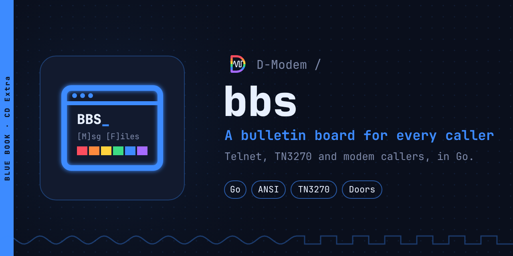
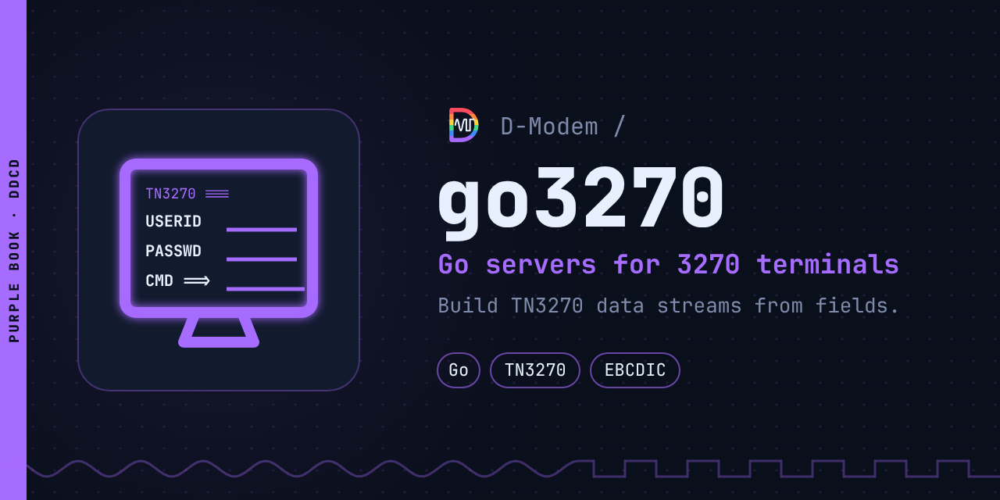
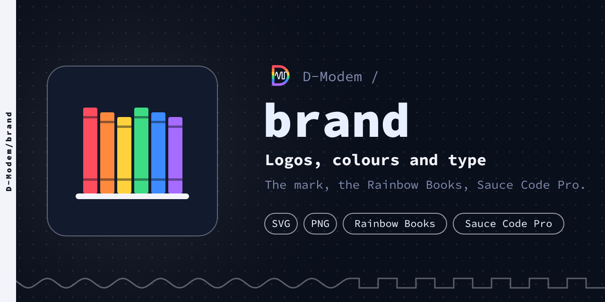
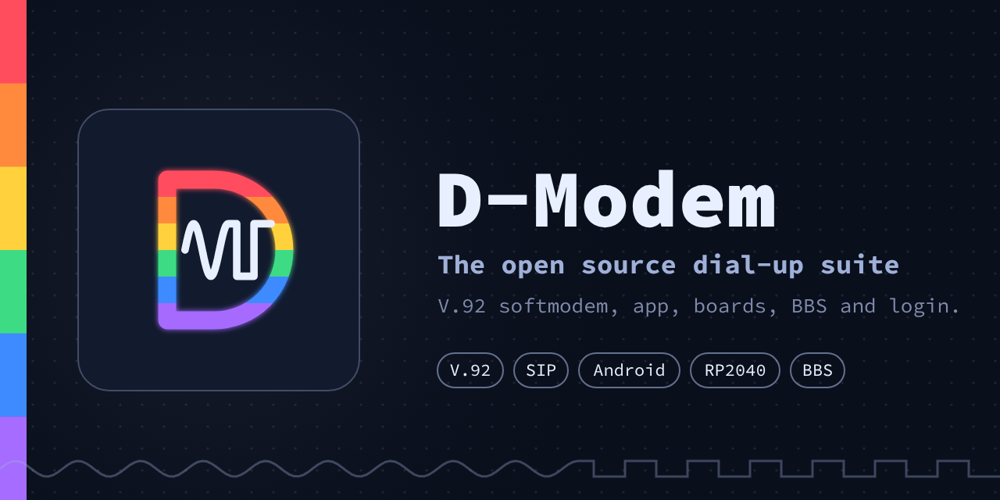
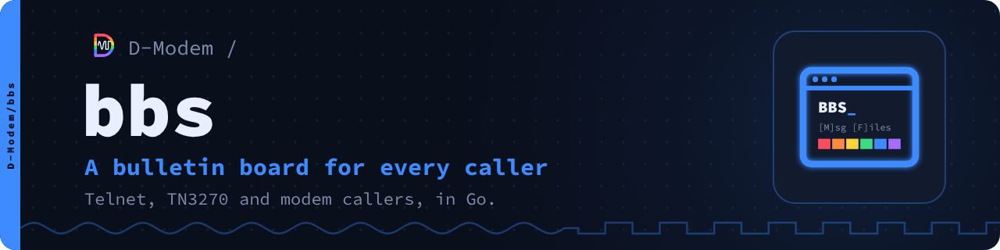

# Assets: previews, upload and generation

## Previews

| | |
| --- | --- |
|  |  |
|  |  |
|  |  |
|  |  |
|  | |

## README banners

`banner/<repo>.svg` is the 1280×320 header at the top of the README of each
repository. It is rendered to `banner/<repo>.png` and `banner/<repo>@2x.png`.
`banner/suite.png` is the banner of the organization, for the profile and
website.

Each repository keeps a copy of its `@2x` PNG at `.github/banner.png`, and
shows it above its title. `tools/art.py <repo> --install <checkout>` does
these two steps:

```html
: <tagline>" width="100%">
```



## Upload to GitHub

GitHub has no API for these images. Thus you must upload them manually:

- **Org avatar:** in the Settings of the organization, go to Profile →
  Profile picture → upload `avatar/org-avatar@2x.png`.
- **Social previews:** in the Settings of each repository, go to General →
  Social preview → Edit → Upload an image → `social/<repo>.png`.

## How to make the art of one repository

`tools/art.py` makes the banner and social preview of a repository. It can
also put the banner in the checkout of the repository:

    python3 tools/art.py menu                       # banner/menu.* and social/menu.*
    python3 tools/art.py menu --install ../menu     # also ../menu/.github/banner.png and README.md
    python3 tools/art.py menu --only social         # just the social preview

For a new repository, add it to `REPOS` at the top of `tools/gen.py` (Book,
colour, icon, tagline, line below, tags). You can also try it first with
flags:

    python3 tools/art.py foo --book Beige --tag "What foo is" --sub "One more line." --icon wave --chips Go,SIP

`python3 tools/art.py -h` lists the Books and icons.

## How to generate the images again

`tools/gen.py` generates the SVGs. The colors, taglines and tags are at the
top of this file. `tools/render.js` renders the SVGs to PNG with the Chromium
of Playwright. Sauce Code Pro (`SauceCodePro Nerd Font Mono`) must be installed, to render the text
correctly. The SVGs name it as their font. Thus a viewer that does not have
the font uses another monospace font.

    python3 tools/gen.py
    python3 tools/app_icon.py
    node tools/render.js
